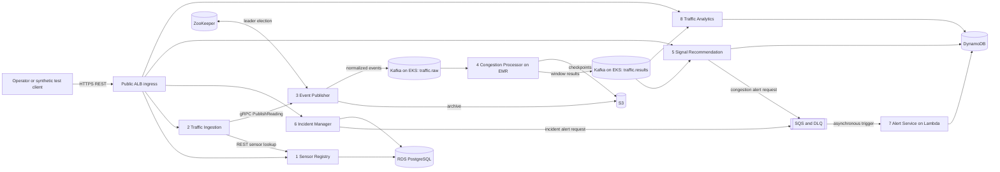
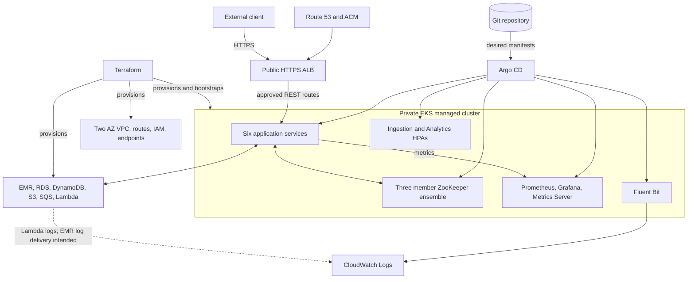
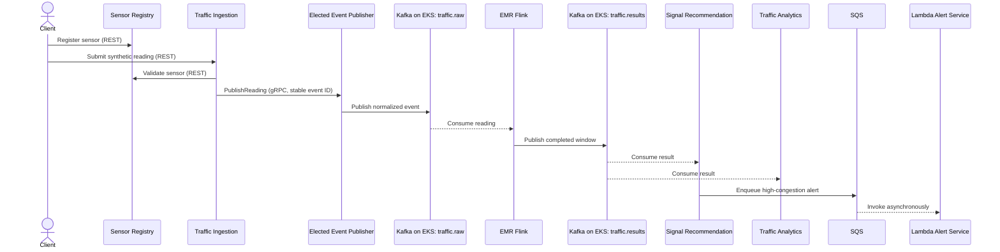

# Smart Traffic Management — Design Document

**Scenario:** S12, simulated intersection congestion monitoring  
**Document date:** 22 November 2026
**Status:** Current run is ready on 23 November 2026 with four t3.large EKS workers, approved private-DNS Kafka routing, managed EMR/Flink and Lambda. See [current evidence](evidence/private-dns-live-2026-11-23.md). Full sustained-load and failover acceptance are not claimed.

## 1. System overview

Smart Traffic Management accepts synthetic readings from registered intersection sensors, calculates congestion over time windows, proposes **simulated** signal changes, records incidents, issues asynchronous alerts, and exposes traffic summaries. It is an academic cloud computing system; it never controls physical traffic signals. The application has exactly the eight prescribed S12 microservices. Kafka, ZooKeeper, databases, ingress, and monitoring components are infrastructure rather than extra application services.

The main traffic path begins with a REST reading. Traffic Ingestion validates the sensor through Sensor Registry, then calls the elected Event Publisher over gRPC. The publisher archives a normalized event in S3 and writes it to the `traffic.raw` Kafka topic. The Congestion Processor runs Apache Flink on Amazon EMR and writes event-time window results to the separate `traffic.results` topic. Signal Recommendation and Traffic Analytics consume that topic independently. A high-congestion recommendation can enqueue an alert. Separately, Incident Manager persists an incident and its outbox entry together, then sends an alert request. SQS invokes the Lambda Alert Service, which stores an alert outcome.

## 2. Cloud deployment architecture

The approved deployment is in AWS `ap-south-1` (Mumbai). Terraform owns the VPC, networking, IAM, EKS, EMR, RDS, DynamoDB, S3, SQS/Lambda, ECR, DNS/certificate integration, and platform bootstrap. Argo CD tracks Git and owns the Kubernetes application manifests and updates. The AWS Load Balancer Controller creates the public ALB from the GitOps Ingress, while ExternalDNS manages its Route 53 record. The public API host is `api.smarttrafficmgmt.online`; ACM supplies the TLS certificate. The application workloads and data services use private networking. The hosted zone and certificate are managed in separate Terraform state so they can be retained between short lived application runs.

The six Kubernetes services are Sensor Registry, Traffic Ingestion, Event Publisher, Signal Recommendation, Incident Manager, and Traffic Analytics. Event Publisher and ZooKeeper run as StatefulSets; ZooKeeper has three persistent members. The Congestion Processor is one Java 17 application service running Flink 1.20 on an EMR 7.14 managed cluster, with S3 checkpoints. The Alert Service is one Python Lambda function. Kafka uses one persistent combined KRaft broker/controller on EKS, with a headless Service publishing the broker pod address through VPC-private DNS, preserving TLS for EMR access. Two t3.large workers provide four raw vCPUs and 16 GiB RAM for light demos. The four-worker HPA profile provides eight raw vCPUs and 32 GiB RAM; both profiles require cloud capacity validation. Worker count is selected explicitly; no node autoscaler is configured. Six immutable images and checksummed Lambda/Flink binaries are retained in separate artifact state between runs. RDS PostgreSQL owns relational sensor and incident data; DynamoDB stores service-owned derived records and alert outcomes; S3 stores normalized event archives and Flink artifacts/checkpoints. These are three distinct cloud storage products, while Kafka serves as the message stream.

Only selected REST routes are exposed through the ALB. gRPC, Kafka, ZooKeeper, and data stores remain private. Workload IAM identities scope access to each service's resources, and generated database credentials are delivered through managed secret references. The approved security design calls for authenticated and limited public access; the recorded strict HTTPS test proves certificate validation and a successful API request, **not** that authentication or rate limits were independently verified. No credential belongs in Git or an image.

## 3. Microservices architecture and responsibilities

| # | Service and runtime | Responsibility | Main inputs and outputs | Owned state |
|---|---|---|---|---|
| 1 | **Sensor Registry**, EKS | Manage intersections and sensors; validate sensor identity and status. | REST CRUD and sensor lookup for Ingestion and Incident Manager. | Its PostgreSQL schema and tables. |
| 2 | **Traffic Ingestion**, EKS | Validate readings and registered sensor references; preserve event IDs and timestamps. | REST `POST /readings` → Registry REST lookup → Publisher gRPC receipt. | No primary business table. |
| 3 | **Event Publisher**, EKS | Normalize and archive accepted readings; publish them only while elected leader. | gRPC `PublishReading` → S3 normalized archive and Kafka `traffic.raw`; ZooKeeper election state. | Deterministic S3 archive objects. |
| 4 | **Congestion Processor**, EMR Flink | Deduplicate event IDs within a bounded horizon and compute stateful per-intersection event-time windows. | Kafka `traffic.raw` → Kafka `traffic.results`; S3 checkpoints. | Flink state and checkpoints. |
| 5 | **Signal Recommendation**, EKS | Turn congestion results into deterministic, simulation-only signal guidance; request congestion alerts. | Independent `traffic.results` consumer, REST reads, SQS alert requests. | Its DynamoDB recommendations table. |
| 6 | **Incident Manager**, EKS | Manage incident lifecycle and reliably request incident alerts. | REST incident CRUD → SQL transaction and outbox → SQS. | Its PostgreSQL schema, incident and outbox tables. |
| 7 | **Alert Service**, Lambda | Process congestion and incident alert requests asynchronously; handle duplicate delivery and batch failures. | SQS trigger → DynamoDB alert outcome and CloudWatch logs. | Its DynamoDB alerts table. |
| 8 | **Traffic Analytics**, EKS | Persist and query Flink results and publisher recovery events without redoing Flink aggregation. | Independent `traffic.results` consumer, recovery events, REST summaries. | Its DynamoDB summaries and recovery records. |

### Traffic and incident interactions

Incident alerts use a second entry path: `Client → Incident Manager REST → PostgreSQL incident and outbox → SQS → Lambda Alert Service → DynamoDB`. The SQL outbox keeps an incident revision and pending alert request in the same transaction. Its worker retries queue delivery and marks the entry sent only after acknowledgement. The Lambda handler uses a stable alert ID so repeated SQS deliveries do not create a second logical alert.

## 4. Interconnection mechanisms and delivery semantics

| Mechanism | Path | Why it is used and what it guarantees |
|---|---|---|
| HTTPS REST | Client → public APIs; Ingestion/Incident Manager → Registry | Human and script accessible APIs, plus synchronous reference checks. The public ALB terminates TLS; private calls have bounded timeouts. |
| gRPC | Ingestion → Event Publisher | A typed internal publication contract with an explicit receipt. Ingestion keeps the same event ID across bounded retries and resolves the elected publisher. |
| Kafka on EKS | Publisher → `traffic.raw` → Flink → `traffic.results` → two consumers | Decouples arrival, window processing, recommendation, and analytics. The processor writes to a distinct results topic; consumers have independent groups. |
| ZooKeeper | Event Publisher replicas | Ephemeral sequential election selects an active publisher. A disconnected or unelected replica stops accepting new publications; a successor can take over after a crash. |
| SQS and DLQ | Recommendation/Incident Manager → Alert Service | Asynchronous alert delivery and retry isolation from request handling. Lambda can report failed batch items for retry. |
| Storage | PostgreSQL, DynamoDB, S3 | Relational ownership for sensors/incidents; keyed derived state and alerts; deterministic event archives and processor checkpoints. |
| Telemetry | App `/metrics` → Prometheus/Grafana; EKS stdout → Fluent Bit → CloudWatch; Lambda → CloudWatch | Makes request rate, errors, latency, scaling, and domain outcomes inspectable. Central Flink container log delivery remains an open verification gap. |

Flink uses 60-second tumbling event-time windows by intersection, a 10-second out-of-orderness allowance, and bounded event-ID deduplication. Results carry stable window IDs. The processor's Kafka result sink is at least once; consumers use deterministic keys and idempotent writes. S3 archival happens before Publisher's Kafka acknowledgement. A failed or ambiguous attempt can therefore leave an archive without a Kafka record, or produce duplicate Kafka records after retry. ZooKeeper readiness cannot fence a delayed in-flight write from a former leader. The design demonstrates bounded crash recovery and duplicate handling; it does not claim partition-safe exclusive publication, zero loss, or end-to-end exactly-once delivery.

## 5. Rationale behind cloud design choices

| Choice | Rationale and trade-off |
|---|---|
| Six EKS services, one EMR Flink service, one Lambda service | Preserves the eight prescribed responsibilities while meeting managed Kubernetes, managed stream processing, and serverless requirements. A custom ninth application service is unnecessary. |
| EMR on EC2 for Flink | The account rejected Amazon Managed Service for Apache Flink application creation. The approved EMR path was verified historically with private MSK input, a distinct output topic, and S3 checkpoint recovery. EMR and EC2 continue to cost money while running. |
| Argo CD for Kubernetes and Terraform for cloud resources | Gives each resource one owner. Git records application changes, while Terraform plans and state cover infrastructure. Controller-created ALB resources require explicit lifecycle checks during teardown. |
| Separate `traffic.raw` and `traffic.results` topics | Makes raw event delivery and stateful window computation independently observable and lets recommendation and analytics consume the same result without coupling their persistence. |
| ZooKeeper election for Publisher | Demonstrates the assigned coordination concept with observable leader takeover. One active publisher limits effective write throughput, so the two HPAs target Ingestion and Analytics instead. |
| PostgreSQL, DynamoDB, and S3 | Fits relational metadata, keyed derived views, and archived objects/checkpoints respectively, while satisfying the three-product storage requirement. Cross-store writes remain eventually consistent. |
| SQS-triggered Lambda alerts and incident outbox | Keeps alert handling asynchronous and provides retries without making REST incident creation depend on Lambda availability. The queue can redeliver, so alert IDs and conditional writes matter. |
| Private data plane with one HTTPS ingress | Limits public exposure to selected REST APIs. EKS workloads use scoped identities and private access to Kafka, databases, coordination, and processing. NAT, ALB, internal NLB, EKS, and EMR create meaningful idle cost, so runs need cost review and supervised teardown. |
| Prometheus/Grafana, CloudWatch Logs, and two CPU HPAs | Supports the assignment's request and cluster dashboards, centralized logs, and measured scale-out. The single publisher remains a potential bottleneck even when upstream replicas scale. |

## Reduced-startup configuration limits

This approved revision retains the eight-service boundaries, managed EKS/EMR and Lambda, three storage products, GitOps, ZooKeeper and observability requirements. Kafka TLS verifies server identity; it uses private-network access rather than the former MSK IAM client authorization. The single broker and replication factor one deliberately trade broker availability for a simpler demo. EKS and EMR can provision independently, with the Flink job submitted only after broker topics/private DNS are ready. The internal NLB, private DNS and retained artifacts add their own charges. Existing cloud evidence, including the earlier HPA run, is not proof of this new shape's capacity or startup duration. Review state and fresh costs before migration or deployment.
